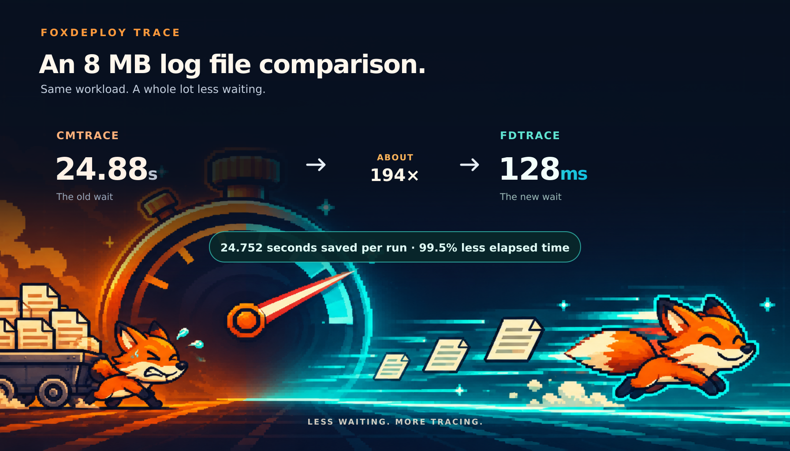

# FDTrace



**FoxDeployTrace**: ultra-speed, ultra-scale log viewing. Built to outpace CMTrace
with three tricks:

- **Compact indexing:** one text buffer, four bytes per line; no eager row copies.
- **Virtualized rows:** create UI items on demand, with a bounded 512-row cache.
- **Lazy formatting:** highlight and clean requested rows, not the entire log.

Saved highlight rules, full-row details, optional PID/TID and null-GUID hiding.
**Help > About** (F1): shortcuts, logo, FoxDeploy blog, and project links.

**Local benchmark:** 10 MiB / 41,776 rows opened in 146 ms; ~20.2 MiB additional
managed memory. Synthetic test, not a head-to-head CMTrace comparison.

```powershell
.\artifacts\portable\win-x64\FDTrace.exe "C:\Logs\gc_agent.log"
```

Windows x64: copy just `FDTrace.exe`; requires the **.NET 8 Desktop Runtime (x64)**.
The runtime is not bundled.

Build: `dotnet publish .\src\FoxDeployTrace -c Release -p:PublishProfile=Portable`.
